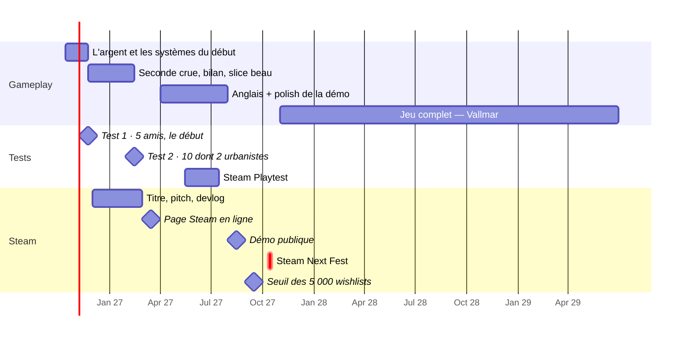

# Feuille de route

> D'ici à la sortie, ce qu'il faut faire, dans quel ordre et à quelle date, **calée sur le rythme réel** des neuf premières semaines. Elle remplace le [[Plan 3 mois]]. Chaque date est une proposition : elle se revoit à chaque jalon, et c'est le jeu qui a raison (109).

## Le rythme mesuré — 10 août → 12 octobre 2026

| | |
|---|---|
| Jours de travail | **41 sur 9 semaines**, soit ~4,5 par semaine, surtout du mardi au jeudi |
| Ce qui a été construit | la chaîne de la carte, la ville en 3D, l'énergie, la densification, le trafic, la crue, les berges, les camps, les ponts, l'université, la mairie, la campagne, les saisons |
| Étapes fermées à l'écran | **1 sur 8** (la carte) ; l'énergie attend un regard, **cinq sont en pause** |

**Ce que ça dit** : on **construit vite**, mais on **ferme lentement**. Un système de plus par semaine est à portée ; un système fini, testé et jugé ne l'est pas encore. Le calendrier ci-dessous ne parie donc pas sur la vitesse : il parie sur la **fermeture**.

**Hypothèse** : le rythme reste à ~4–5 jours par semaine, avec Claude qui écrit le code (40b). S'il baisse, tout glisse d'autant ; s'il monte, on ne rajoute pas de systèmes, on avance les tests.

## Le calendrier

## Les six jalons

| Quand | Jalon | Ce qui doit être vrai | Ce qui prouverait qu'on n'y est pas |
|---|---|---|---|
| **fin nov. 2026** | **L'argent fait hésiter** | les systèmes d'argent du début sont en place, et dans les premières années **au moins une dépense se refuse** faute de caisse | toutes les décisions se paient sans y penser |
| **fin nov. 2026** | **Test 1** — 5 amis joueurs | ils jouent **le début** — de la crue aux premières années de préparation — 30 à 45 min, et on les regarde **sans rien dire** | on a dû expliquer quoi cliquer |
| **mi-fév. 2027** | **Vertical slice + test 2** | 30 à 45 min, belles, du récit au bilan ; 10 testeurs, dont **2 urbanistes** | un urbaniste trouve une causalité fausse |
| **mi-mars 2027** | **Page Steam en ligne** | titre, capsule pro, 5 captures, un GIF avant/après, texte EN + DE | la page part avec des captures de débogage |
| **mi-août 2027** | **Démo publique** | le premier chapitre en anglais, sur Steam, sans plantage | la démo sort la semaine du Next Fest |
| **oct. 2027** | **Steam Next Fest** | la démo a déjà tourné deux mois, les retours sont intégrés | — |

**Pourquoi octobre 2027 et pas juin** : un jeu ne fait **qu'un seul Next Fest**. Juin laisserait trois mois de page et une démo jamais vue ; octobre donne sept mois de wishlists et deux mois de démo publique. Les Next Fest tombent en février, juin et octobre — **dates exactes à vérifier sur Steamworks** avant de s'inscrire.

**Le point de contrôle de [[Marketing et Steam]]** : six mois après la page, **moins de 5 000 wishlists** veut dire que le positionnement ne prend pas — on revoit le pitch et les images avant le Next Fest, pas après.

## Le gameplay, par ordre d'importance

Une seule étape ouverte à la fois, toujours. L'ordre ci-dessous est celui dans lequel on les ouvre.

| | Ce qu'il faut mettre en place | Pourquoi maintenant | Quand |
|---|---|---|---|
| 1 | **L'argent qui fait hésiter** — calibrer les deux formules (59), puis les systèmes d'argent qui manquent (choisis par l'auteur) | aucune décision n'a encore été refusée faute d'argent : il n'y a pas d'arbitrage | avant le test 1 |
| 2 | **Les ouvertures redistribuées** (105, suspendue) et **l'interface allégée** au début | trop d'options d'un coup après le pont | avant le test 1 |
| 3 | **La seconde crue tombe, et un bilan la raconte** | c'est l'examen de tout ce qu'on a préparé, et la preuve que la prévention se voit → [[Boucle de jeu]] | déc. 2026 – janv. 2027 |
| 4 | **Le point de vue épinglé** — la même vue, des années d'écart | c'est la récompense d'une transformation lente, **et** la machine à captures pour Steam | slice |
| 5 | **Une décision signature** : la coupe de rue, ou la place du marché rendue | ce que le joueur montrera ; la page Steam en a besoin → [[Questions ouvertes]] n°5 | slice |
| 6 | **« Croire qu'on y habite »** — fermer Toits et sol, et Trafic | ce sont les images de la page | slice |
| 7 | **Le son** — ambiance, eau, chantier ; quelques sons, pas de musique | une démo muette paraît inachevée | printemps 2027 |
| 8 | **L'anglais** — le système de traduction, reporté par 108 | la page, le Playtest et la démo sont en anglais | avril–juillet 2027 |
| — | Après la démo : la canicule, les transports en commun, quelqu'un qui dit non (n°46), les fins (n°4), les jalons, Vallmar | c'est le jeu complet, pas la démo | à partir de nov. 2027 |

🔴 **Ce qui n'entre pas dans la démo**, même si c'est tentant : Vallmar, un deuxième aléa, de nouveaux thèmes. La démo est **le premier chapitre de Wehrau, fini**.

## Le marketing, sans dépenser avant le slice (48)

| Quand | Quoi | Coût |
|---|---|---|
| déc. 2026 | ✅ **Le titre : *Desire Path*** (111). Reste **le pitch en une phrase** — piste : *« Terra Nil, mais sur une ville que tu reconnais »* | 0 € |
| janv. 2027 → | **Un devlog par mois** ; des GIF avant/après ; Reddit (city-builders, urbanisme), presse **urbanisme et climat** — l'angle *« un urbaniste fait un jeu »* | du temps |
| fév. 2027 | **Commander la capsule** à un artiste, ouvrir Steamworks | 300–1 500 € · 100 $ |
| mars 2027 | **Page en ligne**, un Discord le même jour | 0 € |
| été 2027 | **Trailer maison** de 60 s pour la démo | 0 € |
| après le Next Fest | compositeur, localisation pro, salons → [[Calendrier et budget]] | selon les wishlists |

⚠️ **Tout ce que le joueur voit sur la page est flaggable** (90) : textes, captures retouchées, capsule. La capsule faite par un artiste humain règle la question pour l'image qui compte le plus.

## La sortie

Le jeu complet, c'est [[Vallmar]] : une carte à dessiner, ses six quartiers, et les systèmes mis de côté. Au rythme actuel, **deux ans après le Next Fest** : une sortie vers **2029**, cohérente avec la fourchette de [[Calendrier et budget]] (2,5 à 3,5 ans avec l'IA). À trancher **après le Next Fest**, sur les wishlists : sortie complète directe, ou accès anticipé dès 2028 avec Wehrau seule.

## Les décisions qui t'attendent

1. **Quels systèmes d'argent** avant la seconde crue — voir la proposition de la session du 2026-10-12.
2. ✅ **La démo va jusqu'après la seconde crue** — bilan, puis l'annonce de la canicule (112).
3. ✅ **Le titre : *Desire Path*** (111) — vérifier les marques et le nom de domaine avant la page Steam.
4. ✅ Next Fest d'octobre 2027 (110) · ✅ test 1 : cinq amis joueurs, sur le début.

**Voir aussi** : [[Calendrier et budget]] · [[Marketing et Steam]] · [[Périmètre et coupes]] · [[Boucle de jeu]]
